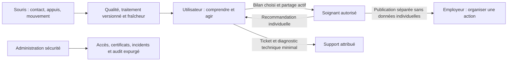

# SKELIVIA — Conception des dashboards P2, fonctionnalités et sécurité

Étude commencée le 13 novembre 2026, enrichie le 14 novembre sur la santé, la prévention et le suivi personnalisé, à discuter avant réalisation. Le but est d'aider chaque persona à prendre une décision utile à partir de données fiables, tout en respectant la proposition d'architecture P2 de 28 pages. Aucun écran, règle métier, droit ou service n'est modifié par cette étude.

La valeur à tester est une boucle courte : observer un usage de la souris, proposer une action compréhensible, puis examiner l'évolution dans un contexte comparable. « Indispensable » reste une hypothèse produit à éprouver auprès des utilisateurs. Une sécurité infaillible ne peut pas être garantie ; la cible est une protection proportionnée, vérifiable et maintenable.

Les fonctions des éditeurs sont documentées sur leurs sites, sans installation ni évaluation clinique de notre part. Les dépôts personnels sont inspectés à des commits précis ; les tests qui y sont cités n'ont pas été exécutés pendant cette étude.

# Décisions fonctionnelles recueillies le 14 novembre 2026

Cette section consigne les réponses explicites oui/non de l'utilisateur, fonction par fonction. Elle prévaut sur le catalogue exploratoire qui suit : une proposition refusée ne fait pas partie du périmètre à réaliser, et une proposition non examinée n'est pas approuvée. « Oui » valide le besoin fonctionnel décrit ; les écrans, mécanismes techniques, protocoles et modalités restent à préciser ensemble avant réalisation, dans l'architecture de référence. Aucun code applicatif ni frontend n'est modifié par cette validation.

## Utilisateur/patient

| Référence de la discussion | Fonction et portée | Décision |
|---|---|---|
| U01 | Journal facultatif de gêne : zone, moment et intensité ressentie. | Non |
| U02 | Suivi de la facilité à réaliser des activités personnelles choisies. | Non |
| U03 | Objectif personnel avec le soignant et date de réévaluation. | Non |
| U04 | Affichage des conseils de prévention personnalisés sélectionnés par le soignant. | Oui |
| U05 | Historique des adaptations essayées, saisi par la personne. | Non |
| U06 | Signalement au soignant d'une difficulté à appliquer un conseil. | Non |
| U07 | Bibliothèque de fiches ou vidéos de prévention. | Non |
| U08 | Préparation d'une consultation avec période sélectionnée et questions. | Non |
| U09 | Demande de réévaluation anticipée du suivi. | Non |
| U10 | Consultation d'un bilan de fin de suivi rédigé par le soignant, conclusions et conseils. | Oui |
| U11 | Questionnaire de santé standardisé choisi par le soignant. | Non |
| U12 | Calibration guidée, résultat et indication d'un besoin d'intervention du support. | Oui |
| U13 | État de connexion, date des dernières données reçues et qualité des mesures. | Oui |
| U14 | Résumé quotidien : contact détecté, appuis relatifs, épisodes de mouvement et périodes manquantes. | Oui |
| U15 | Historique par jour/semaine/mois avec ruptures de calibration signalées. | Oui |
| U16 | Rappels de pause activables, désactivables, reportables et à fréquence réglable. | Oui |
| U17 | Choix des données partagées avec un soignant habilité, durée et révocation. | Oui |
| U18 | Création et suivi de tickets, avec les seules informations techniques nécessaires. | Oui |
| U19 | Téléchargement d'un bilan personnel sur une période choisie, unités, données manquantes et calibrations indiquées. | Oui |
| U20 | Consultation des sessions de son compte et déconnexion d'une session inconnue ou oubliée. | Oui |
| U21 | Alerte de connexion depuis un nouvel appareil uniquement dans le dashboard utilisateur, avec signalement « ce n'est pas moi ». Aucune notification téléphone/montre pour cet événement. | Oui |

Les compléments ci-dessous ont été posés sans numéro dans la conversation ; leurs références servent seulement à les retrouver ici.

| Référence | Complément utilisateur/patient | Décision |
|---|---|---|
| UA01 | Rappels de pause sur téléphone et montre, désactivables et reportables. | Oui |
| UA02 | Alertes de nouvelle connexion sur téléphone et montre. | Non |
| UA03 | Notification téléphone/montre d'un nouveau conseil du soignant, sans contenu médical affiché. | Oui |
| UA04 | Notification téléphone/montre d'un bilan de fin de suivi disponible, sans conclusions affichées. | Oui |
| UA05 | Notification téléphone/montre d'une réponse du support. | Oui |
| UA06 | Alerte téléphone/montre lorsqu'une nouvelle calibration est nécessaire. | Oui |
| UA07 | Choix téléphone, montre, les deux ou aucun pour chaque type de notification retenu. | Oui |
| UA08 | Horaires silencieux, sans son ni vibration, notifications restant consultables dans le dashboard. | Oui |
| UA09 | Taille des textes et contrastes réglables. | Oui |
| UA10 | Historique visible des consultations et exports de données par les soignants. | Non |
| UA11 | Signalement de perte ou remplacement de souris au support. | Oui |
| UA12 | Suivi des mises à jour de la souris : prévues, progression, résultat et recalibration éventuelle. | Oui |
| UA13 | Demande de suppression de compte/données et suivi de son traitement. | Oui |

La compatibilité téléphone/montre et le mécanisme de notification restent à examiner ; cette validation ne présume ni une application native ni l'ajout d'un service à l'architecture. Le refus UA10 concerne l'affichage utilisateur, pas la suppression de la traçabilité de sécurité.

## Soignant

| Référence | Fonction et portée | Décision |
|---|---|---|
| S01 | Liste des patients suivis ; ouverture des bilans avec relation de suivi ET partage actif. | Oui |
| S02 | Synthèse des mesures sur la période autorisée, qualité et calibrations indiquées. | Oui |
| S03 | Comparaison de deux périodes autorisées, limites liées au matériel/calibrations signalées. | Oui |
| S04 | Rédaction et publication de conseils personnalisés, datés et attribués au professionnel. | Oui |
| S05 | Rédaction, validation et transmission au patient du bilan de fin de suivi. | Oui |
| S06 | Correction d'un conseil ou bilan par nouvelle version datée, historique conservé. | Oui |
| S07 | Publication à l'employeur de recommandations matérielles/organisationnelles sans symptômes, mesures individuelles ou bilan médical. | Oui |
| S08 | Suivi de l'avancement des recommandations publiées à l'employeur. La proposition comprenait aussi les obstacles ; le refus ultérieur E04 exclut leur champ de saisie dédié. | Oui |
| S09 | Calendrier personnel de réexamen des dossiers ; accès aux données soumis aux droits encore actifs. | Oui |
| S10 | Demande au patient d'un partage complémentaire motivé. | Non |
| S11 | Téléchargement d'un bilan des mesures par le soignant. | Non |
| S12 | Consultation de l'état/date de calibration dans le dossier autorisé, sans modification technique. | Oui |
| S13 | Information sur les mises à jour affectant calcul, présentation et comparabilité des mesures. | Oui |
| S14 | Consultation et déconnexion des sessions de son propre compte. | Oui |
| S15 | Alerte de connexion suspecte et signalement à l'administration sécurité. | Oui |
| S16 | Création et suivi de tickets techniques, sans dossier patient ni contenu médical. | Oui |
| S17 | Taille des textes et contrastes réglables. | Oui |

Le refus S11 exclut le téléchargement proposé des mesures ; il ne supprime pas la transmission au patient du bilan clinique expressément validée en S05. Le calendrier personnel S09 ne réintroduit pas l'objectif partagé U03 refusé. Les conseils publiés S04 ne réintroduisent pas la bibliothèque U07 refusée.

## Employeur/prévention

| Référence | Fonction et portée | Décision |
|---|---|---|
| E01 | Consultation des recommandations publiées, sans mesures individuelles ni dossiers médicaux. | Oui |
| E02 | Mise à jour du statut à traiter/en cours/réalisée/bloquée, visible par le soignant auteur. | Oui |
| E03 | Attribution d'un responsable et d'une échéance à chaque action. | Non |
| E04 | Motif de blocage, y compris sous forme d'un simple champ facultatif. | Non |
| E05 | Vue d'ensemble du nombre de recommandations par statut, sans données de santé. | Oui |
| E06 | Notification dans le dashboard d'une recommandation nouvelle ou modifiée. | Oui |
| E07 | Historique des recommandations et changements de statut, avec dates. | Oui |
| E08 | Téléchargement d'un récapitulatif des recommandations et de leur avancement, sans données médicales individuelles. | Oui |
| E09 | Taille des textes et contrastes réglables. | Oui |
| E10 | Consultation et déconnexion des sessions dans le dashboard employeur. | Non |

Le statut « bloquée » E02 est conservé sans champ de motif E04. Aucun module de gestion budgétaire, d'achat ou de projet n'est approuvé par ces réponses. Le refus E10 ne retire pas les contrôles d'authentification et de session prévus par l'architecture.

## Support

| Référence | Fonction et portée | Décision |
|---|---|---|
| T01 | Liste des tickets attribués et informations techniques nécessaires, sans données d'usage/santé. | Oui |
| T02 | Réponse aux tickets attribués et statut en cours/en attente/résolu. | Oui |
| T03 | Assistance guidée à la calibration et résultat technique, sans courbes d'usage ni données de santé. | Oui |
| T04 | Diagnostic technique temporaire lié au ticket : connexion, version du logiciel et codes d'erreur. | Oui |
| T05 | Traitement de perte/remplacement, retrait de l'association ancienne et vérification de la nouvelle. | Oui |
| T06 | Lancement d'une mise à jour déjà approuvée par l'administration et vérification du résultat dans une intervention attribuée. | Oui |
| T07 | Historique technique de la souris liée au ticket : réparations, remplacements, calibrations, mises à jour. | Oui |
| T08 | Vérifications après intervention et résultat enregistré avant clôture. | Oui |
| T09 | Signalement d'une anomalie suspecte à l'administration, éléments techniques strictement nécessaires. | Oui |
| T10 | Notifications dashboard : attribution de ticket et nouvelle réponse sur ses tickets. | Oui |
| T11 | Consultation et déconnexion des sessions de son propre compte. | Oui |
| T12 | Taille des textes et contrastes réglables. | Oui |

## Administration sécurité

| Référence | Fonction et portée | Décision |
|---|---|---|
| A01 | Création/suspension/réactivation des comptes et gestion des rôles selon l'architecture, sans contenu médical ni auto-attribution d'un rôle soignant. | Oui |
| A02 | Évaluation et priorité des correctifs : composants concernés, gravité et exposition. | Oui |
| A03 | Résultats des tests, approbation ou report motivé, vérification du déploiement. | Oui |
| A04 | Examen et qualification des alertes de sécurité : incident confirmé ou fausse alerte, sans contenu médical. | Oui |
| A05 | Coupure des sessions suspectes ou suspension temporaire d'un compte compromis, motif et trace. | Oui |
| A06 | Expiration, renouvellement et révocation des certificats de connexion des souris. | Oui |
| A07 | État des sauvegardes et dernier test de restauration, alerte d'échec sans contenu des sauvegardes. | Oui |
| A08 | Journal des actions sensibles : auteur, action et date, sans contenu médical. | Oui |
| A09 | Alerte lorsqu'un composant cesse de transmettre ses journaux de sécurité. | Oui |
| A10 | Suivi d'un incident confirmé : éléments techniques, actions et vérification du retour à la normale. | Oui |
| A11 | Suivi des demandes de suppression et preuve d'exécution selon les règles de conservation, sans contenu médical. | Oui |
| A12 | Contrôle de la fermeture effective des accès temporaires expirés ou révoqués. | Oui |
| A13 | Inventaire des composants, versions installées et fins de support connues. | Oui |
| A14 | Taille des textes et contrastes réglables. | Oui |

## Conséquences pour la suite de la conception

- Les journaux de gêne, activités personnelles, objectifs partagés, questionnaires et demandes de réévaluation refusés ne seront pas introduits via un autre écran ou persona.
- Les protections de l'architecture demeurent obligatoires, indépendamment du choix d'afficher ou non leur gestion dans un dashboard métier.
- Une comparaison de mesures n'établit ni diagnostic ni bénéfice clinique. Les limites de calibration, capteurs simulés, unités et périodes manquantes restent applicables.
- Les décisions croisées S08/E04 sont conciliées en conservant les statuts, sans motif de blocage saisi. Les exports personnels U19 et organisationnels E08 ne donnent pas un export au soignant, refusé en S11.
- La clarification U21 est terminée : alerte uniquement dans le dashboard validée. Les 87 décisions consignées ci-dessus comprennent 71 oui et 16 non. La revue porte maintenant sur les parcours et le frontend ; ces réponses n'autorisent pas à réaliser les écrans avant cette revue.

# Direction visuelle SKELIVIA — choix recueillis le 14 novembre 2026

## Identité et références fournies

L'utilisateur fournit un logo **SKELIVIA** et un visuel de souris argentée portant ce logo. Le nom SKELIVIA et la famille de couleurs des images deviennent les références visuelles pour les quatre espaces métier et l'administration sécurité. Les appellations techniques des projets et leur architecture ne sont pas renommées par cette décision.

Les références montrent du bleu marine, du bleu royal, du turquoise/cyan, du blanc et du gris argent. Il s'agit d'une lecture visuelle des images fournies, pas d'une extraction de codes colorimétriques exacts. Le logo existant doit être conservé comme identité ; il ne faut pas en inventer une nouvelle version. Le visuel produit ne constitue pas une preuve des capacités matérielles de la souris du TP.

## Choix explicitement validés

- **Surfaces :** fond clair blanc/gris.
- **Navigation :** menu vertical bleu marine à gauche sur ordinateur, logo en haut et rubriques propres au persona. Sur téléphone, menu repliable derrière un bouton « Menu ». Disposition validée explicitement par l'utilisateur.
- **Barre supérieure :** titre de la page à gauche, notifications et menu du compte à droite. Disposition validée explicitement par l'utilisateur ; seuls les événements retenus pour le persona alimentent les notifications.
- **Accueil utilisateur :** état de la souris et calibration en haut ; résumé des mesures et évolution au centre ; conseils du soignant et dernier bilan disponibles en dessous. Ordre validé explicitement par l'utilisateur, dans les limites des fonctionnalités retenues.
- **Accueil soignant :** liste des patients suivis au centre et rappels de dossiers à réexaminer à droite ; sur téléphone, rappels sous la liste. Sélection d'un patient pour ouvrir son bilan sous réserve de la relation de suivi et du partage actifs. Disposition validée explicitement par l'utilisateur.
- **Accueil employeur/prévention :** résumé du nombre de recommandations par statut en haut, puis tableau des recommandations avec statut modifiable. Disposition validée explicitement par l'utilisateur ; aucune donnée médicale individuelle, aucun responsable, aucune échéance ni champ de motif de blocage ajouté.
- **Accueil support :** liste des tickets attribués au centre ; détail du ticket sélectionné et actions techniques autorisées dans un panneau à droite. Sur téléphone, détail sur une page dédiée. Disposition validée explicitement par l'utilisateur ; aucune donnée d'usage ni de santé dans ces vues.
- **Accueil administration sécurité :** alertes à examiner en haut ; mises à jour à traiter au centre ; état des sauvegardes, certificats et journaux à droite. Sur téléphone, sections les unes sous les autres. Disposition validée explicitement par l'utilisateur. Les cinq organisations d'accueil sont désormais validées ; les composants détaillés et leur rendu restent à examiner.
- **Graphiques utilisateur et soignant :** graphiques simples et séparés pour le temps de contact détecté, les appuis relatifs et les épisodes de mouvement, avec unités et périodes sans données clairement indiquées. Présentation validée explicitement par l'utilisateur ; accès limité aux données autorisées et conservation des limites de mesure du TP.
- **Période des graphiques :** sélecteur commun « Jour / Semaine / Mois » au-dessus des graphiques, modifiant leur période ensemble dans la limite des données autorisées. Validé explicitement par l'utilisateur.
- **Supports :** les cinq dashboards doivent être utilisables dans un navigateur sur iPhone, Android, tablette, PC et Mac, en portrait/paysage et au toucher/clavier. Les tests de formats et moteurs doivent être distingués des essais sur appareils physiques. La compatibilité des notifications de montre reste un sujet distinct.
- **Accents :** turquoise et bleu, cohérents avec le logo.
- **Structure :** tableaux lisibles, formes simples, peu arrondies.
- **Grands titres :** forme typographique inspirée du lettrage du logo SKELIVIA, suivant la demande explicite de l'utilisateur. Direction de préparation : capitales épaisses, inclinées vers la droite, géométrie anguleuse et proportions assez larges. La police exacte du logo n'est pas identifiée.
- **Référence de composants :** examiner le projet personnel Atelier et réutiliser les composants appropriés si cela aide, dans les limites de l'architecture de P2.

L'utilisateur demande « pas de forme IA ». L'interprétation de travail est une interface de métier sobre : mise en page structurée, tableaux et formulaires nets, décor limité. Éviter les amas de cartes interchangeables, formes flottantes, effets de verre et halos décoratifs. Cette interprétation guide la préparation ; les écrans concrets restent à valider.

## Points à préparer pour la revue des écrans

- Garder une typographie droite et lisible pour les tableaux, formulaires, boutons et textes courants ; réserver l'effet du logo aux grands titres. Vérifier accents français, retours à la ligne et lecture à petite largeur.
- Choisir une police disponible et autorisée, ou une approximation typographique explicitement présentée comme telle ; ne pas présenter un nom de police supposé comme celui du logo.
- Réserver les couleurs de statut à leur sens et les accompagner de libellés/icônes ; le turquoise clair doit être vérifié pour le contraste avant utilisation sur fond blanc.
- Examiner les composants et dépendances d'Atelier avant sélection. Le frontend P2 actuellement inspecté est en HTML/CSS/JavaScript sans framework dans `projet2/app/static` ; aucune migration de framework n'est approuvée implicitement.
- Valider navigation, disposition des informations et écrans de chaque persona avant réalisation. Les nouvelles images ne modifient ni les fonctions refusées ni les règles d'accès.

## Composants Atelier repérés en lecture seule

Projet retrouvé : `E:\Archive_Web_design\studio-createur-sites`, dépôt [lebretyves/atelier_Web](https://github.com/lebretyves/atelier_Web/tree/227ccc87fb4b7a561a1209ac06ad63ab795c933f), commit inspecté `227ccc87fb4b7a561a1209ac06ad63ab795c933f`. La sélection ci-dessous est une proposition de réemploi, pas une intégration réalisée. Elle vise les comportements natifs HTML/CSS/JavaScript, sans importer l'éditeur GrapesJS, Electron ou l'outillage React du catalogue.

| Élément existant | Source Atelier | Usage proposé dans le périmètre retenu |
|---|---|---|
| Navigation responsive | [public/ui-app-shell.js](https://github.com/lebretyves/atelier_Web/blob/227ccc87fb4b7a561a1209ac06ad63ab795c933f/public/ui-app-shell.js#L3) et [public/app-shell.css](https://github.com/lebretyves/atelier_Web/blob/227ccc87fb4b7a561a1209ac06ad63ab795c933f/public/app-shell.css#L1) | Base du menu validé : ouverture mobile, fermeture Échap, retour du focus et état accessible. Extraire le comportement utile sans les fonctions d'assistant présentes dans le module complet. |
| Tableau interactif | [public/advanced-block-runtime.js](https://github.com/lebretyves/atelier_Web/blob/227ccc87fb4b7a561a1209ac06ad63ab795c933f/public/advanced-block-runtime.js#L24) | Listes autorisées : patients, tickets, recommandations, composants techniques. Recherche, tri, pagination et état vide à sélectionner lors de la revue des écrans. Le filtrage côté navigateur ne remplace jamais les autorisations serveur. |
| Onglets accessibles | [public/universal-interactions.js](https://github.com/lebretyves/atelier_Web/blob/227ccc87fb4b7a561a1209ac06ad63ab795c933f/public/universal-interactions.js#L119) | Navigation clavier entre vues d'une même fiche lorsque cette disposition est retenue ; intitulés et contenu encore à décider. |
| Boîte de dialogue | [public/universal-interactions.js](https://github.com/lebretyves/atelier_Web/blob/227ccc87fb4b7a561a1209ac06ad63ab795c933f/public/universal-interactions.js#L40) | Récapitulatif d'une action sensible comme partager ou révoquer ; dialogue natif et gestion du focus. Les contrôles effectifs restent côté FastAPI. |
| Formulaire par étapes | [public/form-flow.js](https://github.com/lebretyves/atelier_Web/blob/227ccc87fb4b7a561a1209ac06ad63ab795c933f/public/form-flow.js#L6) | Parcours de calibration approuvé : progression, précédent/suivant, erreurs associées aux champs. Adapter les requêtes à l'authentification et aux protections de P2. Aucun questionnaire de santé refusé n'est réintroduit. |
| Indicateur de statut avec texte | [entrée Dot Badge NudaUI](https://github.com/lebretyves/atelier_Web/blob/227ccc87fb4b7a561a1209ac06ad63ab795c933f/library-data/components/dbefad9c62b10b09dfd5dd73.json) | Connexion, données manquantes, état de ticket ou partage. Entrée de catalogue HTML/CSS avec notice MIT vérifiée ; attribution à conserver. Le statut ne doit pas reposer sur la couleur seule. |

Les cinq premiers éléments sont du code existant du projet personnel, dont l'utilisateur autorise l'examen et le réemploi approprié. Aucune licence publique générale n'a été identifiée dans les fichiers suivis recherchés : ne pas les présenter comme du code tiers sous MIT. La licence des éléments tiers doit rester attachée à chaque reprise. Les tests existants d'Atelier n'ont pas été exécutés pendant cette recherche ; la sélection n'est pas une validation d'intégration ou d'accessibilité dans SKELIVIA.

**Typographie :** la première maquette utilisait Saira ExtraBold Italic. Après revue, l'utilisateur demande des lettres plus conformes à celles du logo ; cette première piste est donc écartée pour les grands titres. La correction préparée utilise Orbitron 900, en capitales avec une oblique visuelle modérée, depuis la [source officielle](https://github.com/google/fonts/blob/main/ofl/orbitron/Orbitron%5Bwght%5D.ttf), avec sa [licence SIL OFL 1.1](https://raw.githubusercontent.com/google/fonts/main/ofl/orbitron/OFL.txt). Ce choix reprend le style géométrique mais n'est pas présenté comme l'identification certaine de la police du logo. Pour les textes courants, la pile droite `Segoe UI, system-ui, sans-serif` d'Atelier est conservée. Les polices sont servies localement avec leur notice.

**Retour sur la première présentation :** l'utilisateur a précisé « logo pas le bon », puis « sinon oui mais gros titre mem format de texte que logo ». La disposition et le rendu général sont acceptés, sous réserve de corriger logo et grands titres. Le véritable PNG fourni dans son message a été retrouvé et copié à l'identique dans [les ressources de la maquette](../maquette/assets/skelivia-logo-original.png). Il remplace la signature typographique temporaire ; aucune modification des pixels, couleurs ou proportions n'est autorisée par cette correction. Les deux images originales sont répertoriées dans [la provenance des visuels](ressources/origines-visuels.json). Les captures et la validation de l'itération 1 ne constituent pas une validation automatique du nouveau lettrage.

Après validation de ces choix, l'utilisateur a demandé « oui commence ». Une première maquette navigable isolée des cinq espaces est donc autorisée pour vérifier le rendu avec des données fictives. À sa demande ultérieure de tout regrouper, la conception, la maquette, ses ressources et ses vérifications sont désormais réunies sous `dashboards/`, avec la maquette dans `dashboards/maquette`. Aucune modification de l'application ni connexion à ses données n'est réalisée à ce stade. La validation du rendu précède l'intégration au projet. Ce statut remplace les mentions antérieures indiquant qu'aucune maquette n'était commencée ; les fonctions refusées restent exclues.

**Première maquette livrée pour revue le 14 novembre 2026 :** [ouvrir les fichiers de présentation](../maquette/index.html), [parcours et limites](../maquette/README.md), [résultats des vérifications](../README.md). Les cinq espaces sont navigables avec leurs principales actions simulées. Les contrôles enregistrés couvrent 56 vérifications de navigation/formats, 18 parcours et contrôles WebKit et 25 contrôles complémentaires de supports/orientations, sans échec dans les résultats finaux. La revue visuelle indépendante a conclu PASS pour cette maquette de revue. Ces résultats ne démontrent ni sécurité de production ni compatibilité avec chaque appareil physique ; le rendu attend maintenant l'avis de l'utilisateur avant intégration.

# Périmètre à conserver

Quatre espaces métier : utilisateur, soignant, employeur/prévention et support. L'administration sécurité constitue un cinquième espace distinct.

- L'utilisateur voit ses informations et maîtrise les partages.
- Le soignant doit avoir une relation de suivi ET un partage actif pour accéder au bilan.
- L'employeur reçoit des recommandations publiées et gère des actions. Aucun indicateur individuel, suivi de pauses ou agrégat de santé au premier lot.
- Le support traite les tickets attribués et les diagnostics techniques nécessaires, sans appuis, courbes d'usage ou messages médicaux.
- L'administrateur gère les accès et incidents, sans accès médical habituel ni auto-attribution de droits.

La pile reste FastAPI, PostgreSQL, Keycloak, Mosquitto privé et un worker d'ingestion ; PSC et FHIR sont à spécifier selon le contexte prévu. Les logiciels comparés servent de références de fonctions, pas de remplacement de la stack. Le frontend et chaque fonction nouvelle attendent la revue conjointe demandée par l'utilisateur.

Référence : architecture P2, pages 3 à 7, 14 et 15. Les choix de durée de conservation et de reprise du document restent des propositions à valider.

# Ce que montrent les logiciels du marché et GitHub

| Référence | Fonction documentée utile | Transposition proposée et limite |
| --- | --- | --- |
| [R-Go Break](https://www.r-go-tools.com/r-go-break-software/) | Rappels personnalisables et retour LED sur les équipements compatibles. | Retour discret pour l'utilisateur. Les pages consultées ne documentent pas de mesure de l'appui de préhension ; ne pas reprendre leur vocabulaire comme score médical. |
| [Wellnomics WorkPace](https://wellnomics.com/solutions/stretch-break-coaching-tool/) | Rappels adaptés à l'usage informatique ; outils d'autoévaluation du poste. | Rappels contextualisés et réglables. Le reporting de symptômes aux managers présenté dans [un autre module](https://wellnomics.com/discomfort-assessment/) est incompatible avec notre architecture. |
| [Physitrack](https://www.physitrack.com/en-gb/features?no_redirect=true) | Programmes personnalisés, messagerie et suivi dans le temps. | Retenir la boucle bilan partagé, lecture, recommandation et suivi. Prescription, téléconsultation et alertes de douleur ne deviennent pas des exigences du TP. |
| [Workrave](https://workrave.org/docs/windows/statistics/) et [son dépôt](https://github.com/rcaelers/workrave) | Statistiques séparant pauses naturelles, suggérées, ignorées et reportées. | Réduire les rappels gênants et permettre de reporter. Une interruption de contact avec notre souris n'est pas la preuve d'une pause de travail. |
| [ActivityWatch](https://activitywatch.net/) et [son dépôt](https://github.com/ActivityWatch/activitywatch) | Historique personnel, maîtrise locale, export et suppression. | Choix de période et maîtrise des données. Exclure son suivi des applications, titres de fenêtres et URL. |
| [ThingsBoard](https://github.com/thingsboard/thingsboard) | Télémétrie, règles et gestion d'objets ; [états de connexion](https://thingsboard.io/docs/user-guide/device-connectivity-status/). | Inspiration pour le diagnostic technique, sans exposer les mesures personnelles au support. Ne pas ajouter cette plateforme à la stack. |
| [GLPI](https://www.glpi-project.org/en/itil/) et [son dépôt](https://github.com/glpi-project/glpi) | Affectation, traitement, délais et clôture des tickets. | Ticket technique pseudonyme, procédure ciblée et remise en service confirmée. Pas de pièce médicale ni d'usurpation de session. |
| [SafetyCulture](https://help.safetyculture.com/005315) | Workflows d'actions, statuts et accès différenciés. | L'employeur organise une action publiée, avec responsable et échéance ; pas un registre médical de salariés. |
| [Keycloak](https://www.keycloak.org/docs/latest/server_admin/index.html) | Identités, MFA, sessions et administration. | Composant déjà prévu pour la sécurité. Une identité soignante authentifiée n'accorde pas un patient. |

Les bénéfices commerciaux annoncés ne démontrent pas l'efficacité de notre souris. Aucun code de ces projets n'est importé. Les licences et versions doivent être vérifiées avant toute réutilisation ; notamment, le README ThingsBoard consulté annonce BUSL 1.1 à partir de 4.4, avec un régime différent pour les versions antérieures.

# Fonctions à discuter par persona

## Utilisateur

Question principale : « Que puis-je comprendre et ajuster, sans être interrompu inutilement ? »

1. État de la souris et qualité des données : connecté, canal indisponible, historique reçu après coupure. Chaque mesure comporte unité, période et qualité.
2. Synthèse personnelle courte : contact observé, séquences, épisodes de mouvement et appuis locaux. Les détails restent accessibles sans imposer six courbes en permanence.
3. Rappel expliqué : observation, durée, règle utilisée et action possible. Reporter, signaler un rappel gênant ou suspendre dans les limites qui seront validées.
4. Comparaison personnelle avant/après un ajustement, à capteurs et conditions comparables ; pas de comparaison entre salariés.
5. Bilan choisi : période, destinataire autorisé, expiration et révocation visibles ; état de consultation fondé sur un accès réellement enregistré.
6. Assistance technique et accès à ses données.
7. Parcours guidé de vérification/calibration autorisée, état et date de la calibration ; distinction avec les simples préférences de rappel. Les opérations nécessitant une référence physique relèvent d'un protocole technique validé.
8. Sessions de son compte, signalement d'un accès suspect et informations sur une mise à jour affectant sa souris ou ses données.

Valeur attendue : comprendre une habitude et vérifier si un changement paraît utile. Critère d'essai : l'utilisateur sait expliquer l'indicateur, choisir une action et maîtriser le partage. Mesurer aussi les rappels jugés inutiles. Un éventuel ressenti de confort est une saisie volontaire à discuter, pas une mesure déduite des capteurs.

## Soignant ou médecin du travail

Question principale : « Que m'apporte ce bilan pour mon échange avec cette personne ? »

1. Liste des bilans réellement accessibles, avec période, qualité, couverture et expiration du partage.
2. Synthèse des évolutions personnelles, avec unités et limites ; détail uniquement sur demande.
3. Comparaison de périodes et annotations de contexte autorisées, sans score diagnostique automatique.
4. États distincts : bilan disponible, ouvert, réponse publiée. Une ouverture n'est pas une prise en charge.
5. Recommandation individuelle et suivi dans le cadre de la relation autorisée.
6. Publication séparée d'une recommandation de prévention organisationnelle, relue pour exclure tout détail permettant d'identifier une personne.
7. Statut de calibration et versions applicables aux bilans autorisés ; repérage des périodes devenues non comparables après remplacement de capteur ou changement de traitement.
8. Sécurité de son propre compte, sessions et signalement d'accès suspects ; information sur les changements affectant les bilans, sans accès à la surveillance globale du système.

Valeur attendue : préparer un échange plus rapidement et expliquer une observation. Critère d'essai : le professionnel peut identifier les limites et formuler une action sans reconstruire toute la télémétrie. Le TP ne devient ni un dispositif d'urgence ni une télésurveillance assurant une réponse permanente.

## Employeur ou responsable prévention

Question principale : « Quelle action dois-je organiser et où en est-elle ? »

1. Recommandations organisationnelles publiées par un professionnel habilité.
2. Action, responsable organisationnel, échéance, état et preuve non médicale de réalisation.
3. Demande de précision sur une action, sans détail individuel.
4. Indicateurs de gestion : actions en cours, échéances dépassées et délai de réalisation.
5. Historique des décisions et ressources de sensibilisation validées.

Valeur attendue : concrétiser la prévention. Critère d'essai : une recommandation peut devenir une action suivie et clôturée. Les comptages portent sur les actions, jamais sur les mesures, symptômes, partages ou comportements des salariés. Aucun canal employeur-support dans le module santé par défaut.

## Support technique

Question principale : « Quel défaut dois-je traiter et comment savoir qu'il est résolu ? »

1. Tickets attribués, catégorie et identifiant technique pseudonyme.
2. Diagnostic autorisé pour une durée bornée : version, qualité des canaux, erreurs d'acquisition et de liaison, dernière réception nécessaire au diagnostic.
3. Distinction entre souris hors ligne, capteur indisponible et donnée périmée.
4. Procédure, intervention et confirmation de remise en service.
5. Export technique minimal et expurgé, uniquement si nécessaire et autorisé.
6. Assistance à une vérification/calibration autorisée, protocole et résultats techniques bornés au ticket ; étalonnage physique sur un banc de référence lorsque nécessaire.
7. Traçabilité des remplacements et contrôle de remise en service après réparation ou mise à jour approuvée.

Valeur attendue : moins d'allers-retours et une remise en service vérifiable. Critère d'essai : résoudre les défauts simulés sans demander de bilan ou de courbe d'appui. Une télémétrie technique peut aussi révéler des habitudes : son accès doit rester limité au ticket.

## Administration sécurité

Question principale : « Qui peut accéder à quoi et puis-je arrêter un accès injustifié ? »

1. Demandes d'habilitation approuvées, comptes et sessions.
2. Suspension et révocation, avec résultat vérifié côté application.
3. État des certificats et échéances, sans affichage des clés privées.
4. Incidents, journaux expurgés et état des sauvegardes/restaurations.
5. Accès exceptionnel fermé par défaut ; si ce mécanisme est retenu, motif, approbateur distinct, périmètre minimal, expiration et revue.
6. Inventaire des versions, évaluation des vulnérabilités et correctifs, preuves de tests, décisions et suivi des déploiements approuvés.
7. Détection d'événements suspects, qualification des incidents, réponse proportionnée et état de couverture de la supervision.

Valeur attendue : maîtriser l'accès et la continuité du service. Critère d'essai : retirer effectivement un accès sans lire les données médicales.

# Transformer les mesures en informations utiles

Le contrat MQTT v2 du TP est la base, pas les promesses des produits comparés. Les bilans P2 actuels sont fictifs et figés ; ils ne sont pas encore alimentés par les capteurs.

| Signal du TP | Information envisageable | Limite indispensable |
| --- | --- | --- |
| FSR pouce et paume, simulés par potentiomètres | Distribution des appuis locaux et durée de dépassement d'un seuil expérimental explicite ; comparaison personnelle. | Les pourcentages sont des fractions de plage simulée. Ce ne sont ni des newtons, ni une pression en pascals, ni la force totale de préhension. |
| Contact capacitif | Contact probable, interruptions observées et contexte des appuis. | Ne mesure ni présence devant le PC, ni travail effectif, ni posture assise, ni pause active. |
| Gyroscope trois axes | Épisodes confirmés par l'algorithme, fréquence rapportée à une durée valide et évolution personnelle. | Un épisode n'est pas nécessairement un geste ergonomique ; orientation de la souris et posture anatomique sont différentes. |
| Accéléromètre | Variations de mouvement et contrôles de cohérence, séparés du comptage gyro. | Pas de distance fiable obtenue en intégrant naïvement l'accélération ; pas de calories ou activité physique. |
| Qualité, séquence, redémarrage et horodatages | Couverture, fraîcheur, trous, rejeux et comparabilité des bilans. | Donnée absente ou invalide = inconnue, jamais zéro ou amélioration. |
| Diagnostics réseau et acquisition | État de service et défaut ciblé pour le support. | Pas de transmission des courbes personnelles au support ni à l'employeur. |

La calibration physique, l'intégration mécanique et la répétabilité précèdent toute conversion de l'appui. Le fabricant décrit notamment l'influence de la mécanique, l'hystérésis et la dérive des FSR : [guide Interlink](https://www.interlinkelectronics.com/downloads/integration-guides/fsr-400-series-integration-guide.pdf).

## Règles de calcul à retenir pour la discussion

- Toujours afficher le dénominateur : durée d'observation, durée de données valides et durée de contact valide ne sont pas interchangeables.
- Une proportion d'appui au-dessus d'un seuil se calcule sur les intervalles où le canal et le contact sont valides. Le temps manquant reste affiché séparément.
- Ne pas additionner les moyennes de journées de durées différentes ; agréger les durées ou échantillons valides selon une méthode documentée.
- Les différences du compteur gyro se calculent à l'intérieur d'un même redémarrage et d'une même version. Un trou peut empêcher de dater les épisodes même si un cumul reste connu.
- Séparer événements confirmés et candidats en cours ; conserver la version de traitement.
- Le flux MQTT à environ un message par seconde ne permet pas de reconstruire le signal traité à 20 Hz. Pour des durées ou distributions précises, prévoir des résumés calculés à l'acquisition dans un futur contrat versionné ; ne pas inventer cette précision dans le dashboard.
- Les rappels transmis comme conditions actuellement vraies ne sont pas autant d'alertes nouvelles : identifier leurs transitions ou épisodes pour éviter de compter plusieurs fois le même rappel.
- Comparer la même personne, le même montage et la même calibration, sur des tâches et durées suffisamment comparables. Une évolution descriptive ne démontre pas un effet causal.

Exemple entièrement fictif : pour deux périodes de 60 minutes de contact valide, 12 puis 6 minutes au-dessus du même seuil expérimental donnent 20 % puis 10 %. Cela décrit une baisse du temps observé au-dessus de ce seuil, pas une réduction de moitié du risque de TMS.

Les essais phyphox au poignet et les appuis sur balance du TP ne valident pas des capteurs intégrés dans une souris. Les seuils accélérés Wokwi (dont 20 s, 70 % ou 5 s selon les règles) restent des paramètres de démonstration.

## Différenciation à tester

La combinaison appuis locaux, contact et mouvement pourrait donner un retour plus contextualisé qu'un minuteur. Commencer par des règles simples, visibles et versionnées. Une IA clinique n'est pas justifiée par les données actuelles.

L'utilité se vérifie dans une boucle « observation → essai d'un ajustement → comparaison → échange choisi ». L'INRS rappelle que la prévention du travail sur écran concerne aussi l'aménagement, le matériel et l'organisation ; les seuls signaux de la souris ne couvrent pas ce problème : [prévention du travail sur écran](https://www.inrs.fr/risques/travail-ecran/prevention-risques.html).

# Parcours compatibles avec l'architecture

L'employeur ne reçoit pas un résumé automatique des données personnelles. Le support n'accède pas au bilan par le ticket. Le flux de sécurité conserve la traçabilité nécessaire sans recopier les mesures.

# Réutilisation fonctionnelle de tes autres projets

Deux dépôts ont été lus à des commits précis, sans exécuter leurs tests.

- **Suivi postopératoire**, commit `49286b4671fd20691d2e99e50a69c49f5bd1633b` : séparation entre alertes directes et historiques dans [PatientDetail.tsx](https://github.com/lebretyves/Monitoring-post-operatoire-a-domicile/blob/49286b4671fd20691d2e99e50a69c49f5bd1633b/services/frontend/src/pages/PatientDetail.tsx#L133), avec [test prévu](https://github.com/lebretyves/Monitoring-post-operatoire-a-domicile/blob/49286b4671fd20691d2e99e50a69c49f5bd1633b/services/backend/app/tests/test_api.py#L736). À transposer pour qu'une reprise réseau n'affiche pas une ancienne mesure comme actuelle.
- **EHPAD Monitor**, commit `bb36e33684e0021bd49bd4dcff539106c68f4004` : états vu, attribué et résolu dans les [routes d'alertes](https://github.com/lebretyves/epitech_mba2_ehpadMonitor/blob/bb36e33684e0021bd49bd4dcff539106c68f4004/backend/app/api/routers/alerts.py#L66). À adapter aux tickets, réponses et actions, en conservant la signification propre à chaque persona.
- **EHPAD Monitor** : [projection de fraîcheur et qualité](https://github.com/lebretyves/epitech_mba2_ehpadMonitor/blob/bb36e33684e0021bd49bd4dcff539106c68f4004/dashboard/public/resident-acquisition.js#L19) et [tests présents](https://github.com/lebretyves/epitech_mba2_ehpadMonitor/blob/bb36e33684e0021bd49bd4dcff539106c68f4004/tests/hardware/resident-acquisition.test.cjs#L20). Conserver la distinction connecté, indisponible et hors ligne ; ne pas copier son délai de péremption sans l'adapter à l'acquisition P2.
- **Suivi postopératoire** : [explication et état d'alerte](https://github.com/lebretyves/Monitoring-post-operatoire-a-domicile/blob/49286b4671fd20691d2e99e50a69c49f5bd1633b/services/frontend/src/components/AlertsPanel.tsx#L167). Retenir l'explication des observations et limites, pas les scores cliniques.

Ne pas importer NEWS, diagnostics différentiels, probabilités de malaise, urgence ou escalade SAMU. Les handlers d'actions inspectés acceptent parfois un auteur déclaré par paramètre ; P2 doit toujours déduire cet auteur de la session validée côté serveur. Ces constats ciblés ne constituent pas un audit exhaustif des dépôts.

# Ce que tes dépôts apportent à la sécurité

Les quatre dépôts suivants ont été échantillonnés. Ils ne sont pas déclarés sûrs ou conformes sur la base de cette lecture.

| Constat dans le code | Reprise proposée pour P2 | Limite constatée |
| --- | --- | --- |
| Infimactch conserve une marque de révocation empêchant une requête retardée de recréer une session détruite. | Tester déconnexion, suspension et révocation avec requêtes simultanées. | Ce mécanisme ne remplace pas Keycloak ni les contrôles de partage côté FastAPI. |
| Infimactch sépare rôle applicatif et rôle de migration PostgreSQL. | Conserver la séparation DDL/métier et ajouter les politiques RLS prévues. | Le refus de créer une table ne prouve pas l'isolation des lignes. |
| Infimactch contient des tests de rotation de clés et une restauration isolée avec réapplication des effacements. | Restaurer aussi les habilitations, révocations et suppressions ; mesurer la reprise. | Tests lus, non exécutés ici. La séparation effective des clés et sauvegardes reste à vérifier. |
| Charles-IA peut accepter un JWT quand la lecture de révocation Redis échoue. | Refuser un nouvel accès sensible quand l'autorisation ne peut pas être vérifiée. | Constat sur le chemin de code, pas démonstration d'exploitation ou état d'un déploiement. |
| EHPAD autorise certains rôles globaux et un accès exceptionnel sans approbateur distinct dans la fonction lue. | Conserver relation ET partage, aucun droit médical global de l'administrateur, double approbation si l'exception est retenue. | Modèle incompatible avec P2 ; ne pas le copier. |
| EHPAD possède des ACL MQTT par objet ; les configurations lues EHPAD/Charles ne montrent pas de TLS et le broker postopératoire autorise l'anonyme. | Retenir la restriction par objet, avec certificats individuels, TLS et révocation. | Ces fichiers ne prouvent pas l'exposition réelle des autres déploiements. |

Preuves exactes :

- **Infimactch**, commit `dce58044aa2889fc2c70e9c6b824aa251e075019` : [session-revocation.ts](https://github.com/lebretyves/Infimactch_Prod/blob/dce58044aa2889fc2c70e9c6b824aa251e075019/backend/src/security/session-revocation.ts#L8), [tests sessions](https://github.com/lebretyves/Infimactch_Prod/blob/dce58044aa2889fc2c70e9c6b824aa251e075019/backend/test/unit/session-security.spec.ts#L4), [rôles PostgreSQL](https://github.com/lebretyves/Infimactch_Prod/blob/dce58044aa2889fc2c70e9c6b824aa251e075019/scripts/security/database-roles.mjs#L10), [rotation des clés](https://github.com/lebretyves/Infimactch_Prod/blob/dce58044aa2889fc2c70e9c6b824aa251e075019/scripts/vault/backup-key.test.mjs#L4), [restauration](https://github.com/lebretyves/Infimactch_Prod/blob/dce58044aa2889fc2c70e9c6b824aa251e075019/scripts/security/restore-test.mjs#L21), [coffre TLS](https://github.com/lebretyves/Infimactch_Prod/blob/dce58044aa2889fc2c70e9c6b824aa251e075019/infra/vault/server.hcl#L9).
- **Charles-IA**, commit `6d813ba7addd0fd5547fba3265d978fc2c9279a4` : [échec permissif de révocation](https://github.com/lebretyves/Charles-IA/blob/6d813ba7addd0fd5547fba3265d978fc2c9279a4/services/backend/app/auth.py#L136), [validation JWT](https://github.com/lebretyves/Charles-IA/blob/6d813ba7addd0fd5547fba3265d978fc2c9279a4/services/backend/app/auth.py#L513), [broker](https://github.com/lebretyves/Charles-IA/blob/6d813ba7addd0fd5547fba3265d978fc2c9279a4/mosquitto/mosquitto.conf).
- **EHPAD Monitor**, commit `bb36e33684e0021bd49bd4dcff539106c68f4004` : [droits globaux](https://github.com/lebretyves/epitech_mba2_ehpadMonitor/blob/bb36e33684e0021bd49bd4dcff539106c68f4004/backend/app/core/security.py#L49), [accès exceptionnel](https://github.com/lebretyves/epitech_mba2_ehpadMonitor/blob/bb36e33684e0021bd49bd4dcff539106c68f4004/backend/app/core/security.py#L68), [ACL objets](https://github.com/lebretyves/epitech_mba2_ehpadMonitor/blob/bb36e33684e0021bd49bd4dcff539106c68f4004/mosquitto/config/acl#L4), [broker](https://github.com/lebretyves/epitech_mba2_ehpadMonitor/blob/bb36e33684e0021bd49bd4dcff539106c68f4004/mosquitto/config/mosquitto.conf).
- **Suivi postopératoire**, commit `49286b4671fd20691d2e99e50a69c49f5bd1633b` : [broker](https://github.com/lebretyves/Monitoring-post-operatoire-a-domicile/blob/49286b4671fd20691d2e99e50a69c49f5bd1633b/infra/mosquitto/mosquitto.conf).

Les concepts sont réutilisables après adaptation et tests ; aucune configuration entière ne doit être copiée au motif qu'elle existe déjà dans un autre projet.

# État de P2 et écarts à fermer

Le banc local a PostgreSQL, des sessions opaques, Argon2, TOTP, protection CSRF, contrôle d'origine, absence de cache et contrôles d'accès API. Les preuves de reprise indiquent 23 tests PostgreSQL réussis. Cela ne représente pas une certification ni un audit complet.

Lecture du code local au 13 novembre 2026, sur la base Git `86701d00830330f676b220a31b00379226445c76` avec modifications PostgreSQL locales :

- **RLS absente.** Le rôle applicatif ne possède pas les tables et n'a pas de privilèges d'administration, mais dispose de SELECT/INSERT/UPDATE/DELETE sur les tables. L'isolation des personnes repose aujourd'hui sur l'API.
- **Identité locale de démonstration.** Keycloak/PSC, enrôlement, récupération et MFA indépendante restent à réaliser. Les secrets TOTP et accès de démonstration sont conservés en clair dans le banc local.
- **HTTP local.** Cookie sans Secure prévu pour le seul loopback ; ce mode ne doit pas devenir le déploiement distant.
- **Audit incomplet pour la cible.** Le modèle enregistre acteur, événement, date et résultat, mais pas l'identifiant de ressource ; lecture et export empruntent le même chemin de journalisation. Le rôle applicatif dispose aussi de droits de modification sur cette table. Il faut préciser l'objet de l'accès, distinguer les actions et protéger les traces contre l'altération ordinaire.
- **Support trop large pour la cible finale.** Le prototype filtre ses tickets par organisation ; l'architecture prévoit des tickets attribués et un diagnostic borné. L'affectation fine reste à concevoir avant les données réelles.
- **Séparation identité/mesures à renforcer.** Elles sont dans des tables de la même base, accessibles au même rôle applicatif ; cela ne constitue pas encore la séparation d'accès restreinte de la cible.
- **Transport objet et exploitation incomplets.** Pas de chaîne P2 capteurs privés TLS, de gestion complète des clés, de chiffrement au repos démontré ou de restauration de service éprouvée.

Fichiers examinés : `projet2/app/main.py`, `models.py`, `database.py`, `postgres_setup.py`, `infra/compose.yaml`, `preuves/VERIFICATION_POSTGRESQL.json`. Il s'agit d'écarts identifiés sur le banc fictif, pas d'une preuve de fuite de données réelles.

# Protection cible et preuves attendues

La cible conserve l'architecture et ajoute des contrôles complémentaires. Aucun contrôle unique ne suffit.

| Frontière | Protection à réaliser ou compléter | Test de refus ou de reprise |
| --- | --- | --- |
| Identité | Keycloak, authentification renforcée, compte privilégié distinct, récupération contrôlée ; PSC selon le périmètre retenu. Privilégier une MFA résistante à l'hameçonnage pour les comptes privilégiés. | Compte suspendu, authentificateur perdu, jeton expiré et service d'identité indisponible. |
| Autorisation | Compte actif, rôle, personne, relation et partage vérifiés pour chaque accès, export et canal temps réel. RLS avec rôle non propriétaire, sans BYPASSRLS, et contexte de session fiable par transaction. | Deux utilisateurs et organisations, soignant non lié, retrait de relation, partage expiré/révoqué, oubli de filtre API. |
| Révocation | Sessions et droits contrôlés côté serveur ; invalidation sans recréation par une requête retardée ; refus si l'autorisation ne peut pas être vérifiée. | Logout simultané à lecture/export, rafraîchissement de jeton et requête déjà ouverte ; mesure de la limite temporelle réelle. |
| Objet et MQTT | Broker privé, TLS avec vérification du serveur, certificat unique par objet, ACL, rotation et révocation. Contrat versionné, déduplication, qualité et fraîcheur. | Mauvais certificat, certificat révoqué, autre topic, usurpation de device_id, rejeu et paquets retardés. |
| Stockage et clés | Données et sauvegardes chiffrées ; coffre/KMS avec droits séparés ; clés hors Git et images ; identités séparées des mesures et permissions réduites par fonction. | Accès support à une table médicale refusé, clé manquante, rotation, récupération de clé selon procédure. |
| Journaux et exports | Journaux expurgés, actions et ressources pseudonymes traçables, droits d'écriture limités et destination protégée ; téléchargements recontrôlés. | Aucun contenu médical dans logs/notifications ; altération refusée ; nouvel export impossible après révocation. |
| Reprise et suppression | Sauvegardes isolées, restauration testée, réapplication des suppressions et révocations, récupération indépendante des clés. | Restauration isolée puis vérification des comptes suspendus, partages révoqués et données effacées. |
| Logiciel et poste | Versions maîtrisées et mises à jour, scan de secrets/dépendances, tests CI, accès administrateur restreint et protection des postes. Firmware signé/protections ESP32 selon matériel réellement retenu. | Dépendance critique, secret ajouté par erreur, mise à jour invalide, incident sur le poste ou le service. |

RLS protège notamment contre les erreurs de filtrage ; elle ne rend pas inoffensive la compromission complète d'une application capable de fixer son propre contexte. Un rôle non propriétaire est nécessaire mais pas suffisant : [documentation PostgreSQL 17](https://www.postgresql.org/docs/17/ddl-rowsecurity.html).

Le TOTP saisi manuellement n'est pas résistant à l'hameçonnage selon le [NIST SP 800-63B](https://pages.nist.gov/800-63-4/sp800-63b.html). Le raccordement Keycloak devra tester la révocation applicative : déconnecter des sessions n'invalide pas automatiquement tous les jetons d'accès déjà émis dans tous les modèles d'intégration. Voir le [guide Keycloak](https://www.keycloak.org/docs/latest/server_admin/index.html).

Mosquitto distingue chiffrement, authentification par certificat et autorisation ; les trois sont nécessaires au modèle prévu : [documentation officielle](https://www.mosquitto.org/man/mosquitto-conf-5.html).

Les tests doivent être rapprochés des scénarios T01–T18 de l'architecture et d'un référentiel de vérification applicative, par exemple [OWASP ASVS 5.0](https://owasp.org/projects/asvs?tab=main). Ajouter une revue indépendante avant un pilote réel ; ne pas confondre le nombre de tests avec une couverture exhaustive.

Les objectifs proposés de perte maximale de 15 minutes et de reprise en 4 heures restent à accepter et démontrer. Prévoir des copies isolées et des exercices de restauration, comme recommandé dans le [guide de sauvegarde ANSSI](https://messervices.cyber.gouv.fr/documents-guides/anssi-fondamentaux-sauvegarde_systemes_dinformation_v1-0.pdf). Les durées 7 jours pour une capture diagnostique volontaire, 90 jours pour l'historique proposé et 6 mois pour les traces restent celles à discuter dans l'architecture, pas des obligations universelles.

Pour le futur pilote de santé, vérifier le certificat et le contrat couvrant les activités réellement utilisées, exploitation et sauvegardes comprises. La certification d'un hébergeur ne certifie pas notre application : [périmètres HDS décrits par l'ANS](https://esante.gouv.fr/produits-services/hds/procedure-de-certification-hebergeur-de-donnees-de-sante).

Le serveur doit traiter certaines données en clair en mémoire : le chiffrement ne supprime ni les risques de compromission du service ni ceux des postes. Une révocation bloque les accès futurs, mais ne peut pas effacer une copie déjà téléchargée. Ces limites doivent rester explicites.

# Calibration et vérification de la souris

Complément demandé par l'utilisateur le 13 novembre 2026. La calibration doit être un parcours partagé entre utilisateur et support, avec des droits différents. Le soignant reçoit la qualité et la provenance utiles à ses bilans. L'administration sécurité protège l'intégrité des configurations, sans choisir les paramètres de mesure ou les seuils métier à la place des responsables habilités.

## Trois opérations à distinguer

1. **Étalonnage physique.** Déterminer la réponse de chaque FSR dans le montage réel à partir de références de force connues, selon un protocole validé. Vérifier répétabilité, hystérésis, plage exploitable et critères d'acceptation. Une consigne « serrez confortablement » ne fournit pas de référence de force. Le guide [Interlink FSR](https://www.interlinkelectronics.com/downloads/integration-guides/fsr-400-series-integration-guide.pdf) décrit l'influence de la mécanique et la nécessité de caractériser le système intégré.
2. **Vérification guidée en usage.** Contrôler la réponse attendue avec/sans contact et au repos/en mouvement, identifier un canal indisponible et appliquer seulement les corrections autorisées par le protocole. Un contact capacitif absent ne suffit pas à autoriser une mise à zéro automatique ; une valeur constante ne suffit pas à conclure à une panne.
3. **Personnalisation des rappels.** Choisir des préférences dans des limites validées. Ce réglage ne modifie pas la calibration physique et ne crée pas un seuil médical individuel.

Le gyroscope peut nécessiter une estimation de biais au repos et des contrôles d'axes selon un protocole propre ; cela ne mesure pas la posture du poignet. Les critères chiffrés de réussite restent à définir avec le matériel réel. Aucune de ces opérations n'est présentée comme une fonction physique déjà validée du TP.

## Répartition des actions

- **Utilisateur :** lancer le parcours autorisé, suivre les étapes, voir réussite/échec et raison compréhensible, connaître la calibration en vigueur, demander une assistance. L'application indique quelles données sont non exploitables pendant le contrôle.
- **Support :** accompagner un ticket attribué, connaître modèle/version du protocole, canal concerné, résultat et référence de calibration. Les signaux personnels restent dans l'espace utilisateur. Une intervention sur banc à charges connues produit des résultats techniques dédiés, distincts des mesures d'usage. Aucun partage d'écran médical ou accès global ne découle de la calibration.
- **Soignant :** voir la validité et la version de calibration des données partagées, demander une vérification lorsque leur qualité pose problème, et identifier une rupture de comparabilité. Il ne modifie pas les coefficients techniques du capteur par son seul rôle de soignant.
- **Administration sécurité :** tracer l'auteur autorisé des changements, contrôler intégrité et diffusion du profil, détecter une modification non approuvée. Aucun accès aux courbes personnelles n'est nécessaire.

Prévoir une fiche versionnée par objet/canal : protocole, matériel, référence utilisée le cas échéant, version firmware/traitement, auteur, date, résultat, conditions et période d'application. Les critères de nouvelle vérification peuvent inclure réparation, remplacement, anomalie technique ou évolution incompatible ; ne pas inventer une échéance universelle.

Une calibration échouée n'écrase pas silencieusement la précédente. La possibilité de continuer avec l'ancienne dépend de sa validité et du défaut observé ; sinon les résultats concernés deviennent indisponibles. Les données historiques gardent leur version d'origine. Toute réanalyse éventuelle produit une nouvelle version identifiable, sans réécrire le passé.

**Recette proposée :** contrôle avec main présente à tort, canal invalide, coupure au milieu du parcours, utilisateur ou technicien non autorisé, changement de capteur et comparaison entre deux calibrations. Vérifier que ni un échec ni une mise à jour ne crée une fausse amélioration des indicateurs.

# Mises à jour de sécurité et détection d'intrusions

## Évaluer les mises à jour avant de les déployer

L'administration sécurité doit disposer d'un suivi des composants réellement installés : firmware, API, interface, dépendances, système, PostgreSQL, Keycloak et broker, avec versions, dates de contrôle et fin de support connue. Un inventaire de composants logiciels (SBOM) peut alimenter ce suivi.

Pour chaque correctif : composant affecté, avis éditeur, applicabilité, gravité, exposition réelle, exploitation connue, risque de régression, décision, responsable et échéance. Une absence de correspondance dans un scanner n'est pas une preuve d'absence de vulnérabilité. La priorité ne doit pas dépendre du seul score de gravité.

Sources utiles pour l'évaluation : le [catalogue CISA des vulnérabilités exploitées, miroir officiel](https://github.com/cisagov/kev-data) et [EPSS de FIRST](https://www.first.org/epss/). EPSS estime l'exploitation d'une vulnérabilité publiée dans les 30 jours ; ce n'est pas la probabilité d'une intrusion dans notre application. La documentation [Wazuh sur les vulnérabilités](https://documentation.wazuh.com/current/user-manual/capabilities/vulnerability-detection/how-it-works.html) illustre la corrélation entre inventaire logiciel et avis de vulnérabilité. Ce sont des références de conception : aucun outil supplémentaire n'est installé ni ajouté automatiquement à l'architecture.

Parcours proposé : **identifié → évalué → testé → approuvé → déployé → vérifié**, ou différé avec motif et mesure compensatoire. Tester en préproduction les droits, la révocation, les migrations et la compatibilité des données/calibrations. Une mise à jour qui touche les unités ou le traitement appelle aussi une validation métier par les personnes habilitées ; l'administrateur sécurité n'approuve pas seul sa portée médicale.

Prévoir déploiement progressif, authenticité des paquets, vérification après redémarrage, fenêtre d'intervention et procédure de récupération. Pour l'ESP32, les mécanismes de [mise à jour OTA, retour arrière et anti-retour à une version de sécurité obsolète](https://docs.espressif.com/projects/esp-idf/en/stable/esp32/api-reference/system/ota.html) dépendent du modèle et de la configuration. Le retour arrière n'est permis que vers une version encore autorisée et compatible ; ce n'est pas une garantie universelle de récupération, notamment pour le bootloader ou les migrations de données.

- **Utilisateur :** information compréhensible, disponibilité prévue, progression et résultat de la mise à jour de son appareil ; vérification/calibration demandée si nécessaire.
- **Support :** intervention attribuée, paquet déjà approuvé, diagnostic d'échec et contrôle de remise en service ; pas d'import libre de firmware.
- **Soignant :** disponibilité du service et changements affectant les bilans autorisés, unités, règles ou comparabilité. Contribution à une validation métier seulement si cette responsabilité lui est explicitement confiée.
- **Administration :** décision technique, preuves, périmètre, résultats et exceptions tracées. La visibilité sur le parc ne lui donne pas les données d'usage des personnes.

**Recette proposée :** paquet altéré/non approuvé, version incompatible, coupure, échec de migration, droits devenus trop larges, calibration invalidée et tentative de retour à une version interdite. Un téléchargement réussi ne vaut pas mise à jour vérifiée.

## Détecter, qualifier et traiter les événements suspects

La supervision administrative peut corréler des événements expurgés de Keycloak, FastAPI, Mosquitto, PostgreSQL, du coffre et des hôtes. Exemples à tester : échecs de connexion répétés, réutilisation d'une session révoquée, tentatives sur plusieurs dossiers hors droit, exports inhabituels, certificat révoqué, publication sur un autre topic, modification non approuvée d'une règle ou calibration, interruption de la collecte de journaux.

Les changements de fichiers sensibles peuvent faire l'objet d'une surveillance d'intégrité, fonction documentée par [Wazuh](https://documentation.wazuh.com/current/getting-started/use-cases/file-integrity.html). Elle ne prouve pas à elle seule une intrusion, et une surveillance réseau ne doit pas être présentée comme capable de lire automatiquement tout le contenu chiffré.

Pour chaque détection : règle/version, source, faits techniques minimaux, horodatage, gravité proposée, responsable, état de qualification et actions. Séparer **événement suspect**, **incident confirmé** et **faux positif**. Afficher aussi les sources non couvertes ou muettes ; « aucune alerte » ne doit pas devenir « aucune intrusion ».

La réponse suit un protocole approuvé : réauthentification, révocation de session ou certificat, restriction ciblée, conservation des preuves et remise en service. Une adresse IP nouvelle ou une seule anomalie ne justifie pas à elle seule un blocage global : VPN, réseaux partagés et déplacements peuvent expliquer le signal. Les actions automatiques devront être bornées, testées et réversibles lorsqu'il est possible de les rendre telles.

**Pour le soignant et l'utilisateur :** liste de leurs sessions, historique de leurs propres connexions, signalement « ce n'était pas moi », révocation des sessions personnelles et notification générique d'un événement pertinent. Le soignant ne reçoit ni les IP des patients ni les journaux de tout le service. Les informations de sécurité sur un dossier restent limitées à son habilitation et au besoin d'information établi. L'administration conserve la surveillance globale.

**Recette proposée :** scénarios suspects contrôlés, événements légitimes similaires, perte d'une source de logs, détection puis révocation effective. Mesurer délai de détection, délai de qualification, couverture et faux positifs ; ne pas afficher un score global de sécurité « 100 % ».

# Autres fonctionnalités utiles proposées

L'utilisateur a précisé que « ip » signifiait ici d'autres fonctionnalités utiles, pas une demande de fonctionnalités réseau/IP ou d'IA. Les ajouts ci-dessous restent à sélectionner ensemble.

- **Utilisateur — bilan de qualité de la journée :** périodes exploitables, manquantes et concernées par une calibration, pour comprendre la fiabilité du résumé.
- **Utilisateur — retour sur les rappels :** « utile », « mauvais moment », « incompréhensible », sans demander de symptôme dans ce retour technique. Utiliser ces réponses pour améliorer le service, pas pour établir une note de santé.
- **Utilisateur — accessibilité et préférences :** taille du texte, contraste, navigation clavier et notifications maîtrisées ; les limites de sécurité demeurent fixes.
- **Utilisateur/support — remplacement ou perte de souris :** désassociation contrôlée, révocation du certificat si nécessaire, rattachement vérifié du nouvel objet et nouvelle vérification avant de comparer les mesures.
- **Soignant — bilan prêt pour la consultation :** période choisie, observations, qualité, versions et recommandations antérieures, pour préparer l'échange avec moins de manipulations.
- **Soignant — suivi de recommandation :** date prévue de réévaluation et retour volontaire du patient dans le canal de suivi autorisé ; aucune promesse de réponse urgente ou permanente.
- **Soignant — disponibilité du suivi :** indiquer les modalités et délais attendus, avec une procédure de remplacement éventuelle qui exige une nouvelle habilitation et un partage adapté, jamais un transfert automatique de tous les dossiers.
- **Employeur — obstacles aux actions :** signaler budget, équipement ou organisation manquants, joindre une preuve non médicale et demander une précision sur la recommandation publiée.
- **Support — carnet de maintenance technique :** réparations, remplacements, versions et résultats de vérification, sans historique d'appui ou de santé.
- **Administration — état réel des protections :** couverture des journaux, correctifs restant à évaluer, certificats à renouveler et dernier exercice de restauration réussi, avec preuves consultables.

L'état de batterie et l'autonomie restante peuvent être étudiés plus tard si la chaîne matérielle permet de les mesurer ou de les estimer de façon documentée. Le calcul théorique d'autonomie du TP ne justifie pas un pourcentage de batterie en direct.

Priorité proposée pour la revue : calibration et qualité, partage et sécurité des comptes, parcours de recommandation et de maintenance, puis confort d'usage. Les lots techniques gardent l'ordre de l'architecture ; aucun nouveau questionnaire de santé, algorithme clinique ou composant de supervision n'est adopté implicitement.

# Complément du 14 novembre : santé, prévention et suivi personnalisé

La demande porte désormais particulièrement sur l'utilité pour la personne et son suivi avec le soignant. Les propositions suivantes complètent le catalogue ; elles ne constituent ni un protocole médical adopté ni une modification des quatre espaces métier et de l'administration séparée.

## Trois sources d'information à distinguer

1. **Observation de la souris :** contact probable, appuis relatifs et épisodes de mouvement selon les limites du contrat, avec qualité, calibration et version. Ce sont des observations instrumentales, pas des symptômes.
2. **Déclaration volontaire de la personne :** gêne, activités devenues difficiles, contexte choisi, objectifs et retour sur une adaptation. Ce serait une nouvelle collecte sensible, à cadrer avant toute réalisation.
3. **Appréciation du professionnel :** interprétation, recommandation et décision datées, attribuées au soignant habilité. Une synthèse automatique ne doit jamais se faire passer pour cette appréciation.

L'INRS présente les [TMS comme multifactoriels](https://www.inrs.fr/risques/tms-troubles-musculosquelettiques/facteurs-risque.html). Notre proposition est donc de contextualiser les mesures, sans produire de score de risque médical à partir des seuls capteurs. Le bénéfice clinique de ce produit reste à évaluer.

## Catalogue santé à examiner ensemble

| Fonction proposée | Utilité pour la personne | Utilité pour le soignant et condition principale |
|---|---|---|
| **Journal bref de gêne** | Déclarer volontairement zone, côté, moment, gêne et contexte ; sauter une réponse. | Suivre ce qui est effectivement ressenti. Formulation, échelle et cadence à choisir ; une saisie maison n'est pas un questionnaire validé. |
| **Activités du quotidien importantes** | Choisir des activités qui comptent : utiliser la souris, cuisiner, écrire ou pratiquer un loisir ; indiquer ce qui devient difficile ou redevient possible. | Évaluer le retentissement fonctionnel rapporté, sans déduire une incapacité administrative ni comparer les personnes entre elles. |
| **Objectif personnel partagé** | Exprimer une priorité concrète et ce qui serait une évolution utile pour soi. | Convenir d'un objectif, d'un indicateur compréhensible et d'une date de revue ; aucune cible universelle d'appui « idéal ». |
| **Contexte de vie et de travail choisi** | Décrire seulement les contraintes utiles : matériel disponible, horaires compatibles, environnement habituel et changements récents. | Comprendre pourquoi une adaptation est réaliste ou impossible. Pas de collecte systématique de sommeil, traitements, antécédents ou vie privée. |
| **Plan de prévention individuel** | Retrouver quelques actions convenues, leur raison et leur date de réévaluation. | Choisir les adaptations avec la personne, en tenant compte du poste, du matériel et de l'organisation ; pas de prescription automatique. |
| **Suivi des adaptations essayées** | Dater un réglage, un changement de matériel ou une action convenue ; indiquer essayé, poursuivi ou arrêté. | Examiner l'évolution du ressenti, des activités et des observations comparables. L'avant/après ne démontre pas à lui seul une causalité. |
| **Obstacles et tolérance** | Signaler « matériel absent », « incompatible avec ma tâche », « difficile à comprendre » ou « gêne supplémentaire ». | Ajuster le plan plutôt que classer la personne comme mauvaise observante ; réponse et responsabilité à définir. |
| **Ressources progressives** | Recevoir une explication courte au moment utile, enregistrer une question et retrouver les conseils approuvés. | Sélectionner un contenu daté et adapté. Les exercices éventuels nécessitent un cadrage professionnel spécifique, pas une génération libre. |
| **Préparation de consultation** | Sélectionner sa période, ses questions, les changements essayés et les faits qu'on souhaite partager. | Disposer d'un résumé séparant mesures, déclarations, limites et recommandations antérieures ; vérifier le partage actif à chaque accès/export. |
| **Demande de réévaluation** | Demander une revue anticipée ou signaler un changement préoccupant ; voir reçu, pris en charge et répondu. | Traiter selon un protocole humain avec horaires, délais, absence et relais. Ce canal ne doit pas être présenté comme un service d'urgence. |
| **Questionnaire standardisé pertinent** | Répondre à certaines étapes convenues, sans multiplication des sollicitations. | Instrument à sélectionner selon population et objectif ; conserver version, complétude et calcul. QuickDASH est une piste, pas un choix acquis. |
| **Bilan de fin de suivi et maintien** | Retrouver les objectifs revus, ce qui reste utile et les modalités pour redemander un avis. | Clôturer explicitement, convenir d'une éventuelle réévaluation et réexaminer les partages. Pas de surveillance implicite permanente après clôture. |

Les [recommandations NICE sur la décision partagée](https://www.nice.org.uk/guidance/ng197/chapter/Recommendations) soutiennent l'attention aux priorités de la personne, un plan convenu et sa révision, y compris anticipée. Elles éclairent la méthode de conception et ne constituent pas une règle juridique française. L'[INRS sur la prévention du travail sur écran](https://www.inrs.fr/risques/travail-ecran/prevention-risques.html) recommande d'agir sur l'aménagement, les équipements et l'organisation : le produit ne doit donc pas réduire la prévention à des rappels individuels.

Le benchmark commercial fournit un exemple concret : [Physitrack permet de programmer des contenus éducatifs et questionnaires à différentes étapes d'un programme](https://support.physitrack.com/article/1912-scheduling-educational-content-and-outcome-measures-at-different-times). Nous pouvons en discuter le principe sans reprendre le logiciel, sa stack ni supposer un bénéfice clinique pour notre dispositif.

Pour QuickDASH, les [conditions de l'Institute for Work & Health](https://dash.iwh.on.ca/download) imposent notamment une autorisation écrite pour l'incorporation dans un produit vendu et interdisent de modifier l'instrument. Vérifier la version française et les droits correspondant à notre usage avant intégration. Aucun questionnaire n'est reproduit dans cette étude et aucun seuil clinique n'est inventé.

## Personnaliser sans créer une fausse référence de santé

- **Selon la situation choisie :** prévention générale sans symptôme déclaré, suivi d'une gêne, ou suivi encadré par un professionnel. Pas de classement automatique en « sain », « à risque » ou « malade ».
- **Selon les priorités :** activités importantes, contraintes, objectif choisi et possibilité de refuser ou modifier le plan.
- **Selon le rythme :** horaires de sollicitation, fréquence de saisie convenue, rappels reportables et mode discret. Une absence de réponse signifie « non renseigné », pas « aucun symptôme ».
- **Selon l'accessibilité :** lisibilité, langage clair, navigation clavier et préférences de notifications ; éviter que le suivi impose de longues interactions à la souris.
- **Selon les conditions de mesure :** appareil, main d'usage déclarée si nécessaire, calibration et contexte connu. La calibration technique ne sert pas à déterminer un seuil individuel de danger.

Pour les comparaisons personnelles, afficher les ruptures de calibration, de matériel et de méthode. Une baisse d'appui simulé ou une baisse du temps de contact ne signifie pas une amélioration de santé. La souris ne mesure pas à elle seule la posture du poignet, la sédentarité, le stress ou la fatigue visuelle ; des modules sur ces thèmes exigeraient d'autres méthodes explicitement validées.

## Fonctions complémentaires du soignant

- **Vue longitudinale du dossier autorisé :** juxtaposer ressenti, activités, adaptations et observations fiables ; conserver les périodes inconnues visibles.
- **Liste des suivis à revoir :** échéances convenues, demandes de la personne et réponses attendues. Pas de classement par un score médical issu des capteurs.
- **Demande ciblée de complément :** demander une période ou une précision utile ; la demande n'élargit pas automatiquement les droits.
- **Note et recommandation versionnées :** brouillon, validation, publication datée puis correction traçable ; distinguer note clinique individuelle et recommandation organisationnelle expurgée.
- **Continuité de suivi :** indiquer absence et modalités de relais ; un autre professionnel doit obtenir l'habilitation et le partage requis, sans ouverture automatique de toute la patientèle.
- **Revue du plan avec la personne :** conserver décision, motif, objectif révisé et prochaine étape. Un questionnaire ou une courbe aide cette revue sans décider à la place du professionnel.

## Utilité pour les autres personas, sans élargir leur accès à la santé

| Persona | Compléments utiles à discuter | Frontière maintenue |
|---|---|---|
| **Employeur/prévention** | Piloter les adaptations organisationnelles publiées : responsable, matériel/budget à prévoir, obstacles, échéance, preuve non médicale de réalisation et réévaluation de l'action. | Pas de journal de gêne, score fonctionnel, observance ou liste des salariés suivis ; pas d'agrégats de santé au premier lot. Les achats restent un périmètre séparé à cadrer. |
| **Support** | Vérification/calibration guidée, contrôle après réparation, regroupement des pannes similaires par version, suivi d'une panne récurrente et remise en service documentée. | Seulement les diagnostics techniques autorisés et tickets attribués. Aucun message médical ni trace personnelle d'appui. Ne pas importer de dumps mémoire susceptibles de contenir des données sensibles. |
| **Administration sécurité** | Vérifier la révocation effective des partages/sessions, l'expiration des accès et des diagnostics, la couverture des contrôles, les correctifs applicables et les exercices de restauration. | Métadonnées nécessaires et journaux expurgés ; pas de lecture habituelle des contenus médicaux. La santé d'un patient n'est pas un indicateur de sécurité. |

Pour le support, [Memfault documente le regroupement d'erreurs similaires et le suivi des récurrences](https://docs.memfault.com/docs/platform/issue-management). Pour l'administration, [Dependency-Track distingue les états de qualification d'une vulnérabilité](https://docs.dependencytrack.org/triage/analysis-states/). Ce sont des inspirations de workflow, sans installation ni changement de stack.

## Exemple d'usage à valider, pas résultat clinique observé

Une personne déclare une gêne en fin de journée et une difficulté dans une activité qu'elle a choisie. Elle partage un bilan contextualisé avec son soignant. Ils conviennent d'une adaptation et d'une date de revue. Le produit conserve la date du changement, le retour volontaire et les mesures exploitables, en signalant toute rupture de calibration. À la revue, la personne rapporte ce qui a changé ; le soignant décide avec elle de poursuivre, modifier ou arrêter. Une éventuelle action matérielle est publiée séparément à l'employeur, sans les symptômes ni le bilan individuel.

La valeur à tester est la capacité à préparer cette discussion et à ajuster un plan faisable. Mesurer d'abord compréhension, charge de saisie, préparation de consultation et suivi des décisions. Une réduction de douleur ou de TMS ne peut pas être annoncée sans une évaluation clinique adaptée.

## Priorités de discussion

**À examiner d'abord :** gêne volontaire, activités importantes, objectif partagé, plan de prévention, suivi d'une adaptation et résumé de consultation. **À cadrer davantage :** questionnaire standardisé, demandes d'aggravation, relais entre professionnels et éventuels exercices. Tous restent soumis à la revue fonctionnelle et frontend demandée par l'utilisateur, dans l'ordre technique de l'architecture.

Avant toute collecte nouvelle : définir finalité, champs strictement nécessaires, caractère facultatif, destinataires, fondement applicable, information de la personne, durée de conservation et responsabilités du suivi. Le partage explicite avec un soignant ne remplace pas ce cadrage. Aucun accès d'aidant ou nouveau persona n'est ajouté implicitement.

# Revue conjointe avant réalisation

Ordre proposé, sans changer les lots de l'architecture :

1. Valider pour chaque persona la décision à prendre, les informations minimales, les actions et les interdictions.
2. Choisir le premier ensemble utilisateur : état fiable, synthèse courte, rappel expliqué et partage maîtrisé. La comparaison avant/après dépend de mesures comparables et de la calibration.
3. Valider les états du parcours soignant et le contenu d'une recommandation publiée à l'employeur.
4. Définir l'affectation des tickets, le diagnostic technique autorisé et son expiration.
5. Valider les critères de sécurité et les preuves de refus/reprise avant toute donnée réelle.
6. Dessiner ensemble les écrans, puis seulement réaliser le périmètre approuvé.

À décider explicitement : protocole de calibration et responsabilités ; utilité et périmètre d'un ressenti volontaire ; réglages autorisés des rappels ; contenu d'un bilan partagé ; durée d'accès ; destinataire des recommandations ; cadence de suivi ; modalités de diagnostic et d'accès exceptionnel ; approbation des mises à jour ; règles de détection et réponses autorisées.

Proposition de recette d'usage : l'utilisateur comprend une observation et maîtrise son partage ; le soignant produit une réponse à partir d'un bilan compréhensible ; l'employeur clôture une action non médicale ; le support résout un défaut sans données de santé ; l'administration prouve une révocation et une restauration. Mesurer succès, temps nécessaire et erreurs de compréhension sur ces tâches, sans promettre de réduction clinique des TMS.

Aucune modification des interfaces ni des fonctions des projets n'a été effectuée dans cette étude. Le benchmark initial de neuf références, les quatre dépôts personnels et les références techniques du complément sont un échantillon ciblé, pas un panorama exhaustif du marché ni un audit complet de tous les dépôts.

# Références locales de l'étude

- [Architecture P2 de référence](../../outputs/P1_ARCHITECTURE_SECURISEE_20261113/Proposition_architecture_securisee_personas_P2.pdf)
- [Contrat MQTT v2](../../work/p1_sauvegarde_collecte_20261112/projet1/wokwi/schema_mqtt.md)
- [Fonctionnement et limites des capteurs](../../work/p1_sauvegarde_collecte_20261112/projet1/wokwi/README.md)
- [Portée des acquisitions réelles du TP](../../work/p1_sauvegarde_collecte_20261112/projet1/donnees/README.md)
- [Banc P2 et limites actuelles](../../work/p1_sauvegarde_collecte_20261112/projet2/README.md)
- [Recette T01 à T18](../../work/p1_sauvegarde_collecte_20261112/projet2/RECETTE_ET_RESTE_A_FAIRE.md)
- [Preuve de reprise PostgreSQL](../../work/p1_sauvegarde_collecte_20261112/projet2/preuves/VERIFICATION_POSTGRESQL.json)

Cette copie locale remplace la création de Page, indisponible pendant l'étude. Aucun document n'a été publié dans un espace partagé ni poussé sur GitHub.

